# Anony-Mouses

**Adult, playful and a little louche.**

A deliberately simple introductions service for consenting adults seeking flirtation, sex and connection. A little about you. A little about what you want. A hello, perhaps a drink—and every next step is yours to choose.

**[Explore the interactive preview →](https://anonymouses.com/)**

> **Current status:** a public, fictional concept preview, plus a separate local development backend. No real memberships, payments or production messages are handled by the public website. The features below describe the intended service; the status table explains what works today.

## A mouse of your own

Your public face is always an **Anony Mouse**, never a real photograph. Start by choosing one of **18 ready-made adult mice**, then make it yours. A chosen name, an introduction and what takes your fancy complete the profile.

- **Proper bloke mice as well as glamour mice.** Racer, Woodsman, Bruiser, Professor, Rocker and Old School join a sharper Silver Fox, Copper and Dapper, alongside Velvet, Rouge, Pearl and the rest of the cast.
- **More than a change of clothes.** Soft, strong-jawed or rugged faces; clean shaven, stubble, moustache or a full beard; crew cuts, swept-back hair, waves, bobs, long hair or bald.
- **Style the whole character.** Fur and hair colours, slender/broad/athletic/curvy builds, bust/chest choices, cocktail dresses, evening jackets, open-neck shirts, leather jackets, knitwear and finishing touches.
- **Instant previews and a surprise button.** Portraits are drawn in code, with the same creator used in the public demo and local member lounge. No photo upload or image-generation request is needed.

These are choices for an alter ego, not verified physical attributes or a requirement to disclose your real appearance. Tasteful and fully clothed: open-minded, never lewd or vulgar. Permitted non-explicit real pictures belong only in private conversations; recipients can still copy or republish them.

## Follow a little spark

- **A neighbourhood, not a house number.** Enter an outward postcode district such as `GU2`; explore an approximate map with gently pulsing introductions and patron-written hints. No full postcode or GPS is needed. Demo positions are illustrative and pulsing does not mean someone is online.
- **A little atmosphere.** Mood filters, a list view, surprise introductions and suggested opening lines make a small interface feel alive. A still-sparks control respects people who prefer less motion.
- **A conversation by mutual choice.** The local backend supports hello requests that the recipient accepts before messages can be exchanged, plus blocking and reporting.
- **Less digital baggage.** Ordinary text and picture messages expire after **14 days**; each patron can keep up to **100 keepsake messages**. Evidence holds and deletion exceptions are explained below.
- **Discretion by design.** Pseudonyms and mouse portraits keep real faces off profiles. Districts are approximate. Patrons choose what to disclose; identity claims remain unverified and absolute anonymity is not promised.

An introduction is not an obligation. Membership buys access to the service, never another person's attention, affection or consent. Caveat emptor: go in with your eyes open and check that the ingredients mix before making the cocktail.

## One month, one clear price

| Offer | One calendar month | Conditions |
| --- | ---: | --- |
| Planned standard price | **£50** | A separate, explicit purchase each time. This is not a claim that £50 was previously charged. |
| Website introductory offer | **£20** | No general offer deadline has been set; do not invent one. |
| Example invitation: `KEELE_SU_10` | **£10** | Purchase by **30 November 2026, 23:59 UK time**; one use per account, no stacking. Demonstrator only: no student-union partnership is implied. |

**Paid upfront. All core features included. No automatic renewal, free trial, per-message fees or ordinary conversation quota.** Fair-use, safety, file-size and storage limits apply; no spam, automation, harassment or traffic that overwhelms the service.

Start now, or choose a start **up to seven days after purchase**. The full calendar month runs from that start; waiting does not consume it. No reason for the delay, moving itinerary or precise future address is requested. Early repeat purchases preserve already-paid time. Each later month costs the price shown when it is explicitly purchased.

The preview demonstrates code entry and start/expiry dates without taking money. The local backend validates invitation prices, expiry and prior redemption, and records fictional payment fixtures idempotently. Codes alone never grant access. Real server-created orders, verified provider callbacks, refunds and cancellation handling remain to be implemented. See [the membership offer and voucher rules](docs/membership-offer.md).

## What works today

| Area | Current implementation |
| --- | --- |
| Public website | GitHub Pages preview at [anonymouses.com](https://anonymouses.com/): mouse creator, fictional map/list profiles, mood filters, surprise introductions, scripted chat, session-only keepsakes and two-step signup/payment demonstration. |
| Mouse creator | 18 presets, editable styling and shared SVG rendering; enum-validated configurations persist in the local backend. Public real-photo profile uploads are excluded. |
| Local member lounge | Persistent accounts, profile editing, approximate district discovery, accepted hellos, private text/non-explicit image attachments, keepsakes, blocking, local reports, recovery and deletion. |
| Membership core | Unpaid accounts, scheduled paid-month test access, manual renewal, exact-price checks, example invitation expiry/single redemption and duplicate-event protection. No real charge or provider verification. |
| Android | [Shared product and interface track](docs/android-track.md) documented; no Android build released. |
| Production | Disabled. Hosting/provider approval, age assurance, real payments, operational moderation, retention/rights processes and launch terms remain outstanding. |

The public preview uses **no analytics or browser storage**. Demo form details, mouse choices, messages and keepsakes remain in page memory and disappear on reload. Hosting and external font requests still disclose technical information to their providers, as explained in the privacy statement below.

GitHub Pages publishes the root of `main`; open `index.html` for the static preview. For persistent fictional-account tests, follow the [local backend instructions](backend/README.md) and open `http://127.0.0.1:8080/members.html`. Use invented details. The commercial member service needs suitable backend hosting; GitHub Pages remains the public preview host.

[Product brief](docs/product-brief.md) · [Priorities and TODOs](TODO.md) · [Membership decision](docs/membership-offer.md) · [Backend setup](backend/README.md) · [Android track](docs/android-track.md)

## Conduct, privacy and reporting policy

**Agreed 17 October 2026.** Anony-Mouses is an introductions service for consenting adults: adult, playful and a little louche, with clear boundaries.

- **No sexually explicit content.** Pornographic pictures, videos and written messages are prohibited in profiles and DMs, even where both participants agree. Flirtation and a non-graphic description of what you seek are welcome. This replaces the earlier plan to permit explicit private images.
- **Private conversations are not routinely read.** We investigate reports and other credible indications of prohibited or illegal activity. Authorised access is limited to what is necessary for the investigation, security or a lawful requirement. This is not a promise of end-to-end encryption or immunity from lawful disclosure.
- **Act promptly and cautiously.** We aim to assess reports rapidly and may restrict access while investigating a credible risk. Confirmed prohibited material is removed; illegal activity can result in immediate account removal. Serious breaches do not receive three chances. Any repeat-breach rule is an enforcement tool, not permission for an initial breach.
- **No abuse or exploitation.** Child sexual abuse or exploitation, grooming, coercion, non-consensual intimate imagery, threats, harassment and fraud are prohibited. Preserve necessary evidence securely and report to the police or other competent authority when required or otherwise lawfully justified. Detected CSEA must follow the statutory NCA reporting process; cooperation and disclosures must be lawful, necessary and appropriately limited.
- **Reporting must be honest.** Deliberately fabricated evidence, knowingly false reports and reporting used to harass others may lead to restrictions or removal, with referral to authorities where warranted. A mistaken or unproven good-faith report is not misconduct. Nobody is punished simply because their complaint is not upheld.
- **Be fair and accountable.** Review the evidence, give reasons and a route to review decisions where lawful and safe, protect reporters' identities as appropriate, and correct mistakes. We aim for the highest moral and ethical standards and ask to be judged by those same standards.

These are the agreed operating rules. Production reporting, operator review, enforcement and appeals still need implementation and testing. Prohibiting pornography does **not** by itself establish exemption from age assurance or other duties: complete the service-specific children's access/risk assessments and document the necessary safeguards before launch. The age-check decision remains open under this revised scope. See [Ofcom's Q&A on moderation, prohibited content and age assurance](https://www.ofcom.org.uk/siteassets/resources/documents/online-safety/information-for-industry/other/online-safety-act-explained-qa-web.pdf?v=409647).

## Data and privacy statement

**Reviewed 17 October 2026 — UK launch plan.** The public site is a fictional preview. The separate member service runs only in local development; live age checks, payments and production retention are not operating. The planned rules below are implementation requirements, not claims that the prototype already complies. Before real registration, we must publish the finished notice in the website and Android app as well as here.

**Our principle: discreet introductions, the least information needed, and no unnecessary history.** Use a pseudonym. We do not plan to require a real name, full postcode, address book, phone number, exact date of birth or GPS location for a dating profile. An age or payment provider may need some of those details for its own job. Pseudonyms do not make data legally anonymous. Membership will require an account, payment and the age/access safeguards established by our assessment of the revised non-explicit service. Whether a third-party age check is necessary remains to be settled; it has not been waived. Optional profile disclosures and marketing consent must remain optional.

### What the law means for this service

- **Adults only; explicit content prohibited.** Allowing pornography in DMs would trigger specific highly effective age-assurance requirements. Our revised policy prohibits it throughout the service. We still need a children's access assessment, appropriate safeguards and genuine enforcement; the ban is not an automatic exemption. A subscription or age declaration alone does not establish that children cannot access the service. Any age check does not certify a patron's name, honesty or safety. [1]
- **Collect less, protect what remains.** UK GDPR and the Data Protection Act 2018, as amended including by the Data (Use and Access) Act 2025, require a lawful purpose, proportionate collection, security, limited retention and an understandable explanation. Age checking does not justify building an identity dossier. Our preferred design receives a verifiable over-18 result, not a copy of the checking documents. [2]
- **Intimate information needs extra protection.** Sexual preferences, orientation and intimate exchanges can be special category data. Providing the service under a contract is not enough on its own: we also need an Article 9 condition. Our proposed condition for patrons' own intimate information is explicit, recorded consent for the specified uses, with withdrawal controls. Consent to marketing is separate. Another person's sensitive information cannot be freely uploaded just because the sender agreed. [3]
- **Reports cannot simply disappear with a chat.** We need risk assessments, clear rules, reporting and complaints processes, and proportionate action against illegal material. Detected child sexual exploitation or abuse (CSEA) has a specific reporting duty to the National Crime Agency. Ordinary expiry must give way to applicable evidence-preservation duties. [1][4]
- **Payments leave financial records.** Tax and accounting rules require records of sales, not a permanent archive of conversations. Payment providers and banks also have their own fraud, regulatory and card-scheme obligations. Provider requirements must be identified as such rather than presented as universal legal demands on patrons. [5]

### What we need, why, and who receives it

This is the minimum-data design for the live service. “Our team” means authorised people with a specific support, security or legal task; it does not mean unrestricted staff browsing.

| Information | Why it is needed / proposed lawful basis | Who receives or can access it | Retention rule or launch target |
| --- | --- | --- | --- |
| Private login, password hash, recovery-code hash and account reference | Sign-in and recovery; performance of the membership contract, UK GDPR Art. 6(1)(b). Passwords/recovery codes must not be stored in readable form. | Our service and contracted hosting/database processors; not other patrons. No email requirement for basic recovery is planned. | Account lifetime; remove on closure, subject to isolated legal records and backup expiry. Set a short, disclosed dormant-account closure rule before launch. |
| Over-18 result, check time, provider/method reference and any necessary expiry, **if an age-check workflow is required** | Enforce and evidence the assessed age gate; Art. 6(1)(c) where needed for an applicable legal obligation, or an assessed Art. 6(1)(f) legitimate interest if appropriate. Finalise necessity and basis before collection. | Age provider performs the check; our service receives the minimum result. Other patrons receive no checking material. | Keep the minimum evidence while the account relies on it; delete on closure unless a specific, documented obligation requires longer. Reject providers demanding unjustified identity retention. |
| A selfie, age estimate or identity document, **only where the chosen age method requires it** | Establish age, with an accessible alternative and a way to challenge mistakes. A face image is not automatically special category biometric data; unique-identification processing requires additional assessment. | Directly to the named age provider and its disclosed subprocessors. Our intended integration does not import the original selfie, document, legal name or birthday. | Provider-specific deletion deadline must be agreed and published **before collection**. Prefer immediate deletion after the check where feasible. No promised “zero retention” until verified. |
| Pseudonym, outward postcode district, description, preferences and chosen mouse-avatar options | Show introductions and approximate district matches; contract plus explicit Art. 9 consent where sensitive data is involved. These are product needs, not government-required identity fields. | Other eligible patrons see what the user chooses to publish; our service and hosting processors store it. District pins are approximate, not a person's position. | Until edited or account closure; backup exception below. Do not add exact location or birthday merely for convenience. |
| Private text, pictures, participants, timestamps and keepsake choices | Deliver requested conversations; contract plus explicit Art. 9 consent where applicable. Metadata is personal data too. | Conversation participants; our service and hosting/private-storage processors. Limited authorised access for support, security, reports or lawful demands. Neither payment nor age provider needs chat contents. | Ordinary messages and attachments expire after **14 days**. Up to **100 keepsakes per patron** remain until unsaved or account closure, subject to the other participant's saved copy and the final deletion rules. Report/legal exceptions below. |
| Payment reference, offer/price, purchase date, chosen start/expiry, status and refund/dispute details | Supply paid access; contract. Keep necessary tax records under legal obligation; handle fraud/disputes under an assessed legitimate interest or applicable legal duty. | Named payment provider, its banks/card networks and relevant fraud services; our service receives transaction status/references. Necessary records may go to our accountant and HMRC. Our service must not receive full card numbers or security codes. | Keep minimal accounting records for the applicable statutory period: normally **6 years from the end of the relevant company financial year**, or **5 years after the relevant 31 January filing deadline** for a sole trader; statutory exceptions can extend this. No chat content belongs in the ledger. |
| Session cookie, IP address and minimal security/access events | Maintain sign-in and prevent attacks; contract for necessary sessions, assessed legitimate interests for security. No advertising tracker is needed. | Our service and infrastructure providers; limited authorised security access. IP addresses can identify or link people. | Proposed first-party security-log limit **14 days**, unless an incident needs a documented, reviewed hold. Local sessions currently expire after **7 days**. Provider logs have separate, published limits. Never log message bodies, passwords, cards or checking documents. |
| Abuse reports, selected evidence and necessary account links | Resolve complaints, protect users and meet applicable safety/reporting duties. Routine handling: assessed legitimate interests; mandatory reporting: legal obligation. Sensitive/offence data also needs a documented Art. 9 / Art. 10 and DPA condition as applicable. | Authorised safety staff; necessary hosting processors; NCA, police, regulators or legal advisers when lawfully required or otherwise lawfully justified. | Ordinary reports: proposed **90-day** limit, reviewed sooner on resolution. **NCA reports have different statutory periods**, below. A report is not permission to retain all unrelated chats. |
| An optional contact address and marketing preference | Reply to a requested enquiry, or send separately opted-in marketing. No marketing consent is required to buy membership. | Our support team and any named mail processor. | Enquiries: proposed **90 days after resolution** unless a dispute needs longer. Marketing: until withdrawal; retain only the minimal suppression entry needed to honour an opt-out. |

### Deletion, evidence and the limits of discretion

**Fourteen days is our ordinary-message rule, not a promise that every copy everywhere vanishes.** A recipient can save a keepsake, download a picture or take a screenshot. Removing your own keepsake does not remove theirs. The current local prototype removes ordinary conversations and their keepsakes when an account is deleted; the production sender-withdrawal/account-closure rules must be settled and shown before patrons send anything. Report evidence is separate.

For CSEA reported to the NCA, regulation 8 of the 2026 Reporting Regulations requires the report reference to be kept for **five years**, and the reported material, submitted information, assessment evidence and specified associated user data for **one year from reporting**. That associated data can include relevant files, communications and account connections from the preceding two weeks. This is an exceptional, restricted evidence store, not a blanket one-year chat archive. These duties are not implemented by the prototype's 90-day report timer. [4]

Our proposed backup limit is **30 days after a live copy is deleted**, with backups encrypted, inaccessible to patrons and used only for recovery. Restores must reapply deletions. This means an expired chat may persist in a backup for that additional period. This target must be tested and agreed with providers before it becomes a live promise. Holds for an actual legal duty or dispute must specify the data, reason and review date, and end when no longer necessary.

**We cannot promise protection from government surveillance or lawful identification.** A valid warrant, order, notice or statutory duty may require disclosure or preservation; sometimes the law prevents notifying the person concerned. We must assess the authority and scope and disclose only what is lawfully required. The Investigatory Powers Act does not, by itself, require every operator to retain everyone's communications data: a retention notice can impose specific requirements. This is not a waiver of our duty to protect data. Other providers may receive demands independently. [6]

A deferred start needs only the selected date and time. We do not request a reason for waiting, a moving itinerary or a precise future address. Any chosen postcode district can be edited and is not proof of physical presence.

The prototype encrypts private content at rest; it is **not end-to-end encrypted**. The service holds the decryption key. HTTPS and storage encryption reduce exposure but cannot make privately exchanged identifiable pictures, payment trails, provider records or someone else's device anonymous.

### Providers, current preview and your choices

The **current public preview** is hosted by **GitHub Pages**, which logs visitors' IP addresses for security. Its stylesheet requests **Google Fonts**, exposing the connection's IP address and browser request information to Google; demo form contents are not sent with that request. Their own policies apply. We should remove the external font request or host fonts ourselves before a live member launch. Public profiles use configurable mouse artwork only, starting from eighteen ready-made adult mice. Playful and open-minded, never lewd or vulgar. Real pictures may be shared privately under the non-explicit rules, but a recipient could copy or republish them; we cannot guarantee their discretion. Avatar styling is self-expression, not verified physical information. No patron records, private media or credentials may be committed to the public GitHub repository. [7]

**IO Zoom (hosting), Didit (age checks) and CCBill (payments) are evaluation candidates, not contracted live recipients.** Before launch we must identify the actual legal entities, subprocessors, countries, retention periods and processor/independent-controller roles. Overseas transfers need an applicable UK adequacy arrangement or appropriate safeguards and assessment. A UK/EU server address alone does not settle that question. We do not plan to sell personal data, target advertising from intimate information, or use private exchanges to train AI.

Patrons must be able to request access, correction, deletion, restriction and applicable portability; object where processing relies on legitimate interests; withdraw consent; and challenge an incorrect age decision. Withdrawal stops the relevant future processing but does not erase justified legal records or undo earlier lawful processing. Rights have legal limits and must respect other people's data. Access requests normally need a response within **one month**, with lawful extensions where applicable. Verify account control proportionately, rather than demanding a passport by default. People can complain to the [ICO](https://ico.org.uk/make-a-complaint/). [8]

**Launch requirements still outstanding:** identify the actual data controller and publish its postal/contact details and privacy contact; complete the data-protection impact assessment, safety/access risk assessments and provider/transfer checks; implement and test the stated retention and rights processes, explicit consent and age-decision review; assess ICO fee/registration and DPO requirements. No invented contact address or provider deletion deadline is supplied here. An unfilled controller/contact section means this is not yet a finished live privacy notice. [9]

Electronic marketing must follow PECR and UK GDPR: individual subscribers normally require prior consent unless a specific exception applies; corporate-address rules differ. A public email address alone is not permission for any campaign. Identify the sender, offer an effective opt-out, and keep marketing separate from membership and intimate data. Necessary authentication cookies can be treated differently from optional tracking; we plan no advertising cookies. [10]

### Authoritative sources

The linked guidance explains the rules; the retention targets described as proposed above are our design choices, not statutory time limits. Some ICO guidance is being updated following the 2025 Act; check the live law and implementation again before launch.

1. [Ofcom: dating services, safety and age checks, including DMs](https://www.ofcom.org.uk/online-safety/illegal-and-harmful-content/dating-and-social-discovery-know-the-online-safety-risks-rules-and-how-to-comply).
2. [ICO: age assurance and data-protection principles](https://ico.org.uk/about-the-ico/what-we-do/information-commissions-opinions/age-assurance-for-the-children-s-code/6-expectations-for-age-assurance-and-data-protection-compliance/).
3. [ICO: special category conditions and explicit consent](https://ico.org.uk/for-organisations/uk-gdpr-guidance-and-resources/lawful-basis/special-category-data/what-are-the-conditions-for-processing/).
4. [Ofcom: CSEA reporting duty](https://www.ofcom.org.uk/online-safety/illegal-and-harmful-content/duty-to-report-child-sexual-exploitation-and-abuse-csea-content-know-the-rules-and-how-to-comply); [Reporting Regulations 2026, regulation 8: retention](https://www.legislation.gov.uk/uksi/2026/268/regulation/8/made).
5. HMRC: [company records](https://www.gov.uk/running-a-limited-company/company-and-accounting-records) and [sole-trader records](https://www.gov.uk/self-employed-records/how-long-to-keep-your-records).
6. [Home Office: Communications Data Code of Practice, including retention notices](https://www.gov.uk/government/consultations/investigatory-powers-act-2016-codes-of-practice/outcome/communications-data-code-of-practice-accessible-version).
7. [GitHub Pages: visitor data collection](https://docs.github.com/en/pages/getting-started-with-github-pages/what-is-github-pages#data-collection); [Google Fonts privacy](https://developers.google.com/fonts/faq/privacy).
8. [ICO: responding to access requests](https://ico.org.uk/for-organisations/uk-gdpr-guidance-and-resources/individual-rights/right-of-access/what-should-we-consider-when-responding-to-a-request/).
9. ICO: [privacy-notice contents](https://ico.org.uk/for-organisations/advice-for-small-organisations/privacy-notices-and-cookies/how-to-write-a-privacy-notice-and-what-goes-in-it/), [DPIAs](https://ico.org.uk/for-organisations/uk-gdpr-guidance-and-resources/accountability-and-governance/data-protection-impact-assessments-dpias/when-do-we-need-to-do-a-dpia/).
10. ICO: [email-marketing rules](https://ico.org.uk/for-organisations/direct-marketing-and-privacy-and-electronic-communications/guidance-on-direct-marketing-using-electronic-mail/how-do-we-comply-with-the-pecr-electronic-mail-marketing-rules/), [PECR changes under the 2025 Act](https://ico.org.uk/about-the-ico/what-we-do/legislation-we-cover/data-use-and-access-act-2025/the-data-use-and-access-act-2025-duaa-summary-of-the-changes/schedules/).

## Development foundation

A separate [local backend](backend/README.md) now implements persistent accounts, district-based discovery and private text conversations. The connected member lounge at `http://127.0.0.1:8080/members.html` supports signup, sign-in, profile editing, schematic district discovery, accepted conversation requests, private text and image messages, keepsakes, blocking, local reports, recovery and deletion. **31 automated tests** cover the core and HTTP journey, including cookies, access isolation, static-file boundaries, scheduled membership, invitation-code pricing/expiry/redemption and saved mouse configurations. Production use is disabled; the public mockup remains fictional.

See the [foundation review](docs/foundation-review.md) for hosting, payment, age assurance and privacy findings and unresolved provider requirements.

## Provider selection and deployment

The [17 October age/access assessment](docs/age-access-assessment.md) concludes that our planned ungated member service is likely to attract under-18s despite its non-explicit rule. An age-only 18+ gate is the recommended launch design, subject to effectiveness/privacy review; a checkbox/payment-only alternative has not been established as adequate. See the [initial illegal-risk register](docs/illegal-risk-register.md), [commercial findings and outstanding acceptance gates](docs/commercial-readiness.md), and [prepared provider enquiries](docs/provider-enquiries.md). These are pre-launch findings: no real service, provider approval, purchase or enquiry submission is claimed.

See [the provider decision and cost model](docs/provider-decision.md) and [the deployment plan](docs/deployment-plan.md). Accounts now start unpaid; an internal monthly-payment ledger is tested, but real provider verification/checkout and production deployment are pending.

## Android track

See [the Android development track](docs/android-track.md) for a shared minimal interface and delivery order. The native app will use the same account/message service; no Android build has been released yet.

## Artwork

Masthead created with AI for Anony-Mouses: a glamorous adult female mouse blowing a Monroe-style kiss to a suave adult male mouse, in saturated Technicolor.

## Ownership

Project by Andy J Myers. No open-source licence has been granted at this stage.
